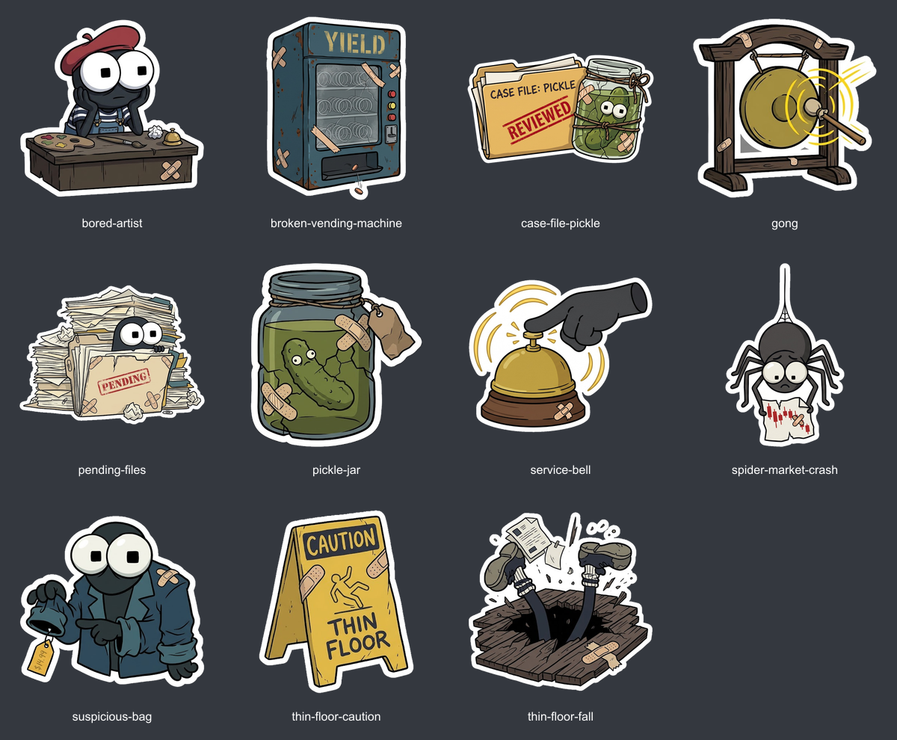

# Fomies — Telegram sticker pack

11 static stickers with transparent backgrounds and the original white sticker borders. Each sticker is available as a 512×512 PNG and lossless WEBP.



## Download

- [Download the complete sticker pack ZIP](download/fomies-tg-stickers.zip).
- Or choose **Code → Download ZIP** to download this repository.
- Individual files: [WEBP](stickers/webp/) · [PNG](stickers/png/).

## Create a Telegram pack

1. Extract the downloaded ZIP.
2. Open [@Stickers](https://t.me/Stickers) in Telegram and send `/newpack`.
3. Choose a pack name.
4. Send each sticker from the ZIP's `telegram-sticker-pack/webp/` folder **as a file/document**, rather than as a photo. If you downloaded the repository, use `stickers/webp/`.
5. After each sticker, send a matching emoji. Suggestions are listed below.
6. Send `/publish` and follow the bot's prompts to choose a short link for the pack.
7. Share the resulting Telegram link so others can add the pack.

The files are ready to upload; this repository does not yet provide a published Telegram pack link.

## Stickers

| File | Illustration | Suggested emoji |
| --- | --- | --- |
| `spider-market-crash` | Spider holding a falling market chart | 🕷️ |
| `service-bell` | Hand ringing a service bell | 🛎️ |
| `case-file-pickle` | Reviewed pickle case file | 📁 |
| `broken-vending-machine` | Broken yield vending machine | 🪙 |
| `thin-floor-caution` | Caution: thin floor | ⚠️ |
| `thin-floor-fall` | Falling through the floor | 🕳️ |
| `bored-artist` | Artist waiting at a desk | 🎨 |
| `suspicious-bag` | Character pointing at a priced bag | 👀 |
| `pickle-jar` | Pickle in a patched jar | 🥒 |
| `gong` | Ringing gong | 🔔 |
| `pending-files` | Character buried in pending files | ⏳ |

## Files

```text
stickers/png/   11 transparent 512×512 PNGs
stickers/webp/  11 transparent 512×512 lossless WEBPs
download/      complete sticker pack ZIP
preview.png    overview of all 11 stickers
validation.json dimension, transparency and file-size checks
```

## Artwork and preparation

Prepared from the supplied illustrations by removing their outer gray/dark backgrounds, retaining the white sticker borders, and fitting each artwork proportionally onto a transparent square canvas. The caution sign and the person falling through the floor were separated from one combined illustration.

All 22 image files were checked for 512×512 dimensions and an alpha channel containing transparent and opaque pixels. All WEBP files are under 180 KB.

This repository distributes image files; Telegram publication is a separate step through @Stickers. No custom emoji files are included.

No license grant for the artwork is included. Public availability does not establish permission for commercial use or imply endorsement by the Fomies team.
